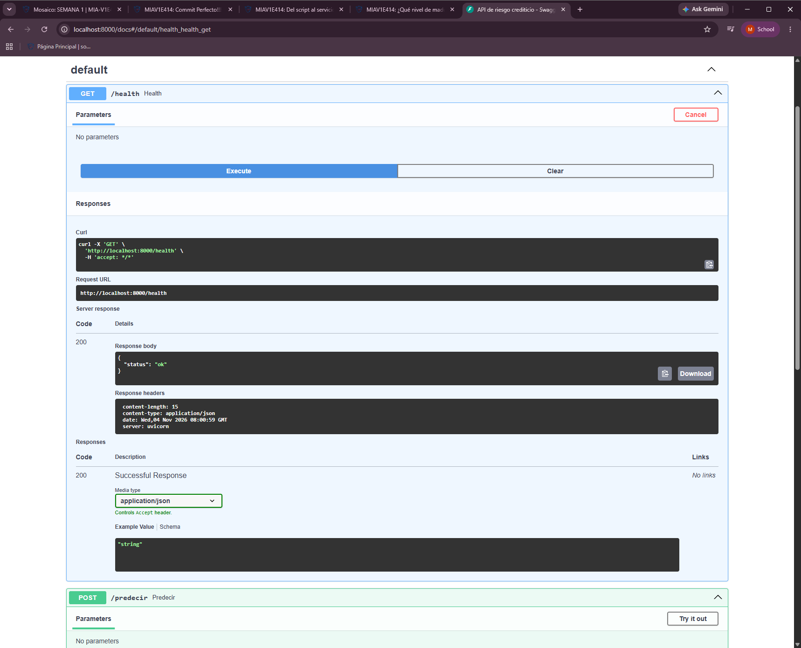
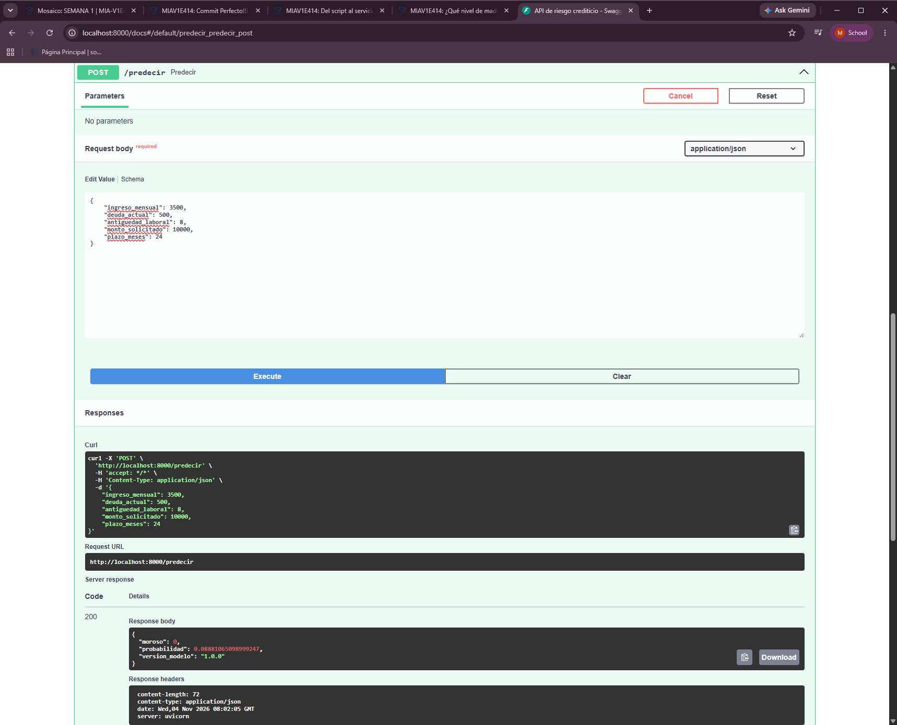

# Respuestas: Del script al servicio (modelo de crédito)

**Módulo:** ML-Ops y Puesta en Producción · Clase 3

Los resultados de este documento provienen de la imagen `credito-api:1.0` y del contenedor
`credito`, ejecutados el 2026-11-04.

---

## 5. Preguntas de verificación

### 1. ¿Por qué `requirements.txt` se copia e instala ANTES que `api.py` en tu Dockerfile? ¿Qué pasa con los rebuilds si lo haces al revés?

Docker construye la imagen por capas y reutiliza cada una mientras no cambie. Cuando una capa
cambia, reconstruye esa y todas las siguientes. Las dependencias cambian poco y el código cambia
seguido, por eso las dependencias van primero:

```dockerfile
COPY requirements.txt .
RUN pip install --no-cache-dir -r requirements.txt

COPY api.py .
COPY modelo_credito.joblib .
```

**Lo que se observó:** el `pip install` tardó 15.3 s al cambiar `requirements.txt`. Después, al
cambiar solo `api.py`, ese paso no se repitió:

```
#7 [3/7] COPY requirements.txt .
#7 CACHED
#8 [4/7] RUN pip install --no-cache-dir -r requirements.txt
#8 CACHED
#9 [5/7] COPY api.py .
#9 DONE 0.0s
```

**Si se hace al revés:** cualquier cambio en `api.py` invalidaría la caché de las capas siguientes.
Cada rebuild repetiría todo el `pip install`, aunque las dependencias fueran las mismas.

### 2. ¿Por qué `modelo_credito.joblib` SÍ va dentro de la imagen, pero el dataset de entrenamiento NO?

- **El modelo sí:** `api.py` lo carga al arrancar y lo usa en cada predicción. Sin él, el servicio
  no funciona. Al incluirlo, la imagen queda autosuficiente y se puede ejecutar en cualquier máquina.
- **El dataset no:** solo se necesita para entrenar, una etapa anterior que el servicio no realiza.
  Incluirlo aumentaría el tamaño de la imagen sin aportar nada a las predicciones y, con datos reales
  de un banco, expondría información sensible de clientes a cualquiera con acceso a la imagen.

En este proyecto, `entrenar.py` genera un dataset sintético en memoria, y ni ese script ni los datos
entran en la imagen. El contenedor solo contiene `api.py`, `modelo_credito.joblib` y
`requirements.txt` en `/app`.

### 3. ¿Por qué el `CMD` usa `--host 0.0.0.0`? ¿Qué pasaría con el default (`127.0.0.1`)?

`0.0.0.0` hace que uvicorn escuche en todas las interfaces de red del contenedor, incluida la que
recibe el tráfico publicado con `-p 8000:8000`. Así se pudo consumir la API desde el host:

```
$ curl -i http://localhost:8000/health
HTTP/1.1 200 OK

{"status":"ok"}
```

Con `127.0.0.1`, uvicorn solo aceptaría conexiones desde dentro del propio contenedor, porque cada
contenedor tiene su propia interfaz de loopback. `docker ps` lo mostraría en estado Up, pero el `curl`
desde el host no obtendría respuesta. Este segundo escenario se describe por cómo funciona la red de
Docker; no se ejecutó como prueba.

### 4. ¿Quién rechaza una petición con ingreso negativo: Docker, FastAPI/Pydantic o el modelo? ¿Por qué es importante que se rechace ANTES de llegar al modelo?

**La rechaza FastAPI/Pydantic**, al validar el contrato `Solicitante`, donde el campo está definido
como `ingreso_mensual: float = Field(gt=0, ...)`. Docker solo transporta el tráfico y no conoce su
contenido, y la petición nunca llega al modelo.

```
HTTP/1.1 422 Unprocessable Entity

{"detail":[{"type":"greater_than","loc":["body","ingreso_mensual"],"msg":"Input should be greater than 0","input":-100,"ctx":{"gt":0.0}}]}
```

**Por qué importa:** el modelo no valida reglas de negocio y responde con cualquier número. Al pasarle
directamente el mismo solicitante con ingreso de -100, sin pasar por la API, devolvió:

```
moroso: 0, probabilidad de mora: 0.37
```

Es decir, clasificó como "cumple" a un solicitante con un dato imposible, sin ninguna señal de error.
Rechazar la petición antes evita decisiones de crédito basadas en datos erróneos y le indica al sistema
cliente qué campo debe corregir.

### 5. Menciona al menos TRES ventajas concretas de tu API contenerizada frente a `predecir_local.py`.

1. **Integración:** cualquier sistema, como la web de créditos del banco, lo consume con una petición
   HTTP, sin instalar Python ni las librerías.
2. **Reproducibilidad:** la imagen lleva la misma versión de Python y de las dependencias a cualquier
   máquina, lo que elimina el "en mi máquina funciona". Al entrenar y construir desde una copia limpia
   de la carpeta, se obtuvieron las mismas probabilidades.
3. **Sin edición manual:** los datos llegan en la petición, en lugar de que un analista edite los valores
   del script para cada solicitante.
4. **Validación automática:** las entradas inválidas se rechazan con un error 422 claro; el script las
   procesaría sin avisar.
5. **Documentación y operación:** `/docs` se genera solo, y `/health` permite que un orquestador
   compruebe si el servicio está vivo.

---

## 6. Entregables

### 6.1 Carpeta del proyecto

Carpeta `entrega/`, sin `.venv` ni `modelo_credito.joblib`:

| Archivo | Contenido |
|---|---|
| `api.py` | Endpoints `GET /health` y `POST /predecir`, con el contrato Pydantic |
| `requirements.txt` | Dependencias con versión fijada (`==`) |
| `Dockerfile` | Base `python:3.11-slim`, dependencias antes que el código y usuario no-root |
| `.dockerignore` | Excluye `.venv`, `.git`, `__pycache__` y los archivos que el servicio no usa |
| `entrenar.py` | Necesario para generar el modelo antes de construir la imagen |

Como el modelo no se entrega, hay que generarlo antes de construir la imagen:

```bash
pip install -r requirements.txt
python entrenar.py
docker build -t credito-api:1.0 .
docker run -d -p 8000:8000 --name credito credito-api:1.0
```

### 6.2 Evidencias

Los archivos están en `evidencias/`.

#### `docker images`: tamaño

Archivo: `docker-images.txt`

```
IMAGE             ID             DISK USAGE   CONTENT SIZE   EXTRA
credito-api:1.0   02dc82bc30f7        602MB          140MB
```

La imagen ocupa 602 MB en disco, muy por debajo de la referencia de 1 GB.

#### `docker ps`: contenedor en ejecución

Archivo: `docker-ps.txt`

```
CONTAINER ID   IMAGE             COMMAND                  CREATED          STATUS          PORTS                                         NAMES
99d53ea3f695   credito-api:1.0   "uvicorn api:app --h…"   33 seconds ago   Up 32 seconds   0.0.0.0:8000->8000/tcp, [::]:8000->8000/tcp   credito
```

#### Solicitante válido 1: bajo riesgo

Archivo: `curl-bajo-riesgo.txt`

```
$ curl -i -X POST http://localhost:8000/predecir -H 'Content-Type: application/json' -d '{"ingreso_mensual":3500,"deuda_actual":500,"antiguedad_laboral":10,"monto_solicitado":4000,"plazo_meses":36}'
HTTP/1.1 200 OK

{"moroso":0,"probabilidad":0.015168425558390777,"version_modelo":"1.0.0"}
```

#### Solicitante válido 2: alto riesgo

Archivo: `curl-alto-riesgo.txt`

```
$ curl -i -X POST http://localhost:8000/predecir -H 'Content-Type: application/json' -d '{"ingreso_mensual":800,"deuda_actual":6000,"antiguedad_laboral":0.5,"monto_solicitado":15000,"plazo_meses":12}'
HTTP/1.1 200 OK

{"moroso":1,"probabilidad":0.9733333333333334,"version_modelo":"1.0.0"}
```

#### Peticiones inválidas

Archivo: `curl-invalido.txt`

Ingreso negativo:

```
$ curl -i -X POST http://localhost:8000/predecir -H 'Content-Type: application/json' -d '{"ingreso_mensual":-100,"deuda_actual":500,"antiguedad_laboral":10,"monto_solicitado":4000,"plazo_meses":36}'
HTTP/1.1 422 Unprocessable Entity

{"detail":[{"type":"greater_than","loc":["body","ingreso_mensual"],"msg":"Input should be greater than 0","input":-100,"ctx":{"gt":0.0}}]}
```

Campo faltante:

```
$ curl -i -X POST http://localhost:8000/predecir -H 'Content-Type: application/json' -d '{"deuda_actual":500,"antiguedad_laboral":10,"monto_solicitado":4000,"plazo_meses":36}'
HTTP/1.1 422 Unprocessable Entity

{"detail":[{"type":"missing","loc":["body","ingreso_mensual"],"msg":"Field required","input":{"deuda_actual":500,"antiguedad_laboral":10,"monto_solicitado":4000,"plazo_meses":36}}]}
```

#### Captura de `/docs`

Ambos endpoints se probaron desde la documentación interactiva que FastAPI genera automáticamente,
en http://localhost:8000/docs.

**`GET /health`** (`Evidencia_1.png`): responde 200 con `{"status":"ok"}`.



**`POST /predecir`** (`Evidencia_2.png`): con ingreso de 3500, deuda de 500, antigüedad de 8 años,
monto de 10000 y plazo de 24 meses, responde 200 con `moroso: 0` y probabilidad de mora de 0.0888.


