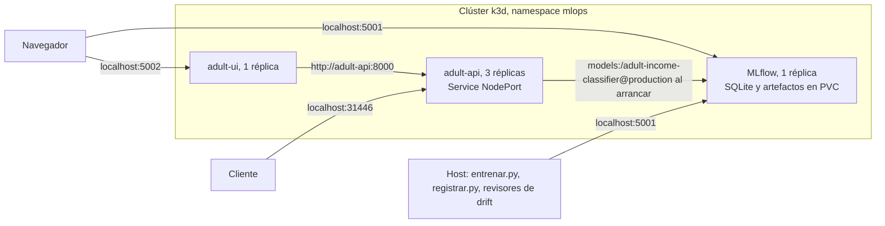

# Documento de arquitectura

Clasificador tabular (UCI Adult) llevado desde el entrenamiento hasta un servicio con réplicas en Kubernetes, con trazabilidad hacia MLflow y pruebas de data drift y concept drift.

## Modelo desplegado

| Modelo registrado | Versión | Alias | Run | Nombre del run | Dataset (SHA-256) | Imagen |
| --- | --- | --- | --- | --- | --- | --- |
| `adult-income-classifier` | **2** | `production` | `a44a07aa727849ef9ba3021fcaa20ecd` | `random-forest_n-300_d-16` | `7537312dd56c2b98035880805ce99e68183a30ee468aa5329d6df0fbb3cc21bb` | `adult-api:0.1.0` |

| Versión | Alias | Run | Origen |
| --- | --- | --- | --- |
| 1 | | `c171aa9083da4fc79e5a342fae52f1fd` | Línea base: mejor regresión logística (`C = 1.0`) |
| 2 | `production` | `a44a07aa727849ef9ba3021fcaa20ecd` | Mejor run por `cv_roc_auc` |
| 3 | `candidato` | `4a1565e88328424e8d1c3424f47551c5` | Reentrenado con la regla nueva simulada; no se despliega |

Se comprueba en vivo: `curl localhost:31446/info` devuelve la versión y el `run_id` que el pod cargó.

**Commit.** Los runs tienen `git_commit = 12e6b83` y `git_dirty = true`, porque el proyecto todavía no estaba versionado al entrenar. Ese commit por sí solo no permite reproducir el código, así que cada run guarda además `datos.py` y `entrenar.py` en sus artefactos (`codigo/`).

## Arquitectura

| Servicio | Tipo | URL en el host | URL dentro del clúster |
| --- | --- | --- | --- |
| API | `NodePort` 31446 | `http://localhost:31446` | `http://adult-api:8000` |
| MLflow | `LoadBalancer` 5001 | `http://localhost:5001` | `http://mlflow:5001` |
| UI | `LoadBalancer` 5002 | `http://localhost:5002` | `http://adult-ui:5002` |

## Decisiones

### 1. Dataset: UCI Adult

Iris, usado en la práctica, tiene 150 filas y ninguna variable categórica: no alcanza para varios lotes ni para una prueba por tipo de variable. Adult tiene 48.813 filas sin duplicados y mezcla ambos tipos.

Se usan 4 variables numéricas y 5 categóricas. Se excluyen `fnlwgt` (peso muestral), `education-num` (duplica `education`) y `race`, `sex` y `native-country` (atributos sensibles que la demo no necesita). **Limitación:** `relationship` incluye `Husband` y `Wife`, por lo que actúa en parte como proxy de `sex`.

### 2. Particiones

División estratificada con semilla 42, generada en `datos.py` y verificada por pruebas:

| Partición | Filas | Uso |
| --- | --- | --- |
| `train` (50 %) | 24.406 | Entrenamiento, validación cruzada y referencia de data drift |
| `test` (20 %) | 9.762 | Métrica final y referencia del concept drift |
| `produccion` (30 %) | 14.645 | Lotes de los escenarios simulados |

### 3. Métrica principal y elección del modelo

La métrica principal es ROC-AUC. `accuracy` también se registra, pero con 76 % de negativos un modelo trivial ya alcanza 0,76. El modelo se elige por `cv_roc_auc` (validación cruzada de 3 particiones), de modo que el test no interviene en la selección.

| Run | `cv_roc_auc` | `test_roc_auc` |
| --- | --- | --- |
| `random-forest_n-300_d-16` (**v2**) | **0,9151** | 0,9190 |
| `random-forest_n-200_d-12` | 0,9137 | 0,9181 |
| `random-forest_n-100_d-8` | 0,9074 | 0,9126 |
| `regresion-logistica_c-1.0` (**v1**) | 0,9063 | 0,9094 |
| `regresion-logistica_c-10.0` | 0,9062 | 0,9094 |
| `regresion-logistica_c-100.0` | 0,9061 | 0,9095 |
| `regresion-logistica_c-0.1` | 0,9055 | 0,9091 |
| `regresion-logistica_c-0.01` | 0,8986 | 0,9045 |

La ventaja del bosque sobre la mejor regresión es de cerca de 0,009. Es pequeña, y una regresión logística sería más simple y liviana; se eligió el bosque por ser el mejor según el criterio definido de antemano. La diferencia entre `n-300` y `n-200` es de solo 0,0014.

### 4. MLflow dentro del clúster

La práctica usa `mlflow server` en el host. Aquí los pods dependerían de un proceso de la máquina anfitriona. Por eso corre como Deployment de 1 réplica, con SQLite y artefactos en un PVC y `--serve-artifacts`, para que ni el host ni los pods necesiten compartir un sistema de archivos. Usa `strategy: Recreate`, porque el volumen es `ReadWriteOnce`.

MLflow es un punto único de fallo para los **arranques** de pods, no para el servicio ya en marcha (ver la decisión 5). En un entorno real se usaría una base de datos gestionada y almacenamiento de objetos.

### 5. El servicio consume el alias al arrancar

El servicio resuelve `models:/adult-income-classifier@production` una sola vez a un número de versión y carga esa versión. La imagen no contiene el modelo. La alternativa, copiarlo en el build, da una imagen autónoma, pero leería una ruta de archivo, lo que el enunciado rechaza.

| Costo aceptado | Cómo se comprobó | Mitigación |
| --- | --- | --- |
| Un pod nuevo necesita MLflow para quedar listo | Con MLflow a 0 réplicas, el pod nuevo quedó `0/1` con `/ready` en `503`, los otros dos siguieron respondiendo `200`, y al volver MLflow quedó `1/1` (`evidencias/16-mlflow-caido.txt`) | `/health` no depende de MLflow; la carga reintenta sin reiniciar el pod |
| Un alias movido no cambia los pods en marcha, y un pod recreado cargaría otra versión | Tras mover el alias, los pods siguieron en v2 hasta el `rollout restart` (`evidencias/09-promocion.txt`) | Toda promoción incluye `kubectl rollout restart` |

### 6. Imagen y dependencias

La imagen usa `python:3.12-slim`, usuario sin privilegios y `mlflow-skinny==3.14.0`, con versiones exactas, incluidas las transitivas, en `requirements.txt` (generado desde `requirements.in`). MLflow 3.14 guarda el modelo como `model.skops`, de modo que `skops` también es obligatorio en el servicio.

El bosque se entrena con `n_jobs=-1`. El servicio fija `n_jobs=1` al cargarlo, para no lanzar un hilo por cada CPU del nodo dentro de un pod limitado a 1 CPU.

### 7. Alta disponibilidad

- 3 réplicas, repartidas entre nodos con `topologySpreadConstraints`.
- `readinessProbe` sobre `/ready` y `livenessProbe` sobre `/health`.
- `preStop` de 5 s, para que el pod salga de los endpoints antes de terminar. Con él, la autorreparación dio **288 peticiones y 0 fallos**.
- El Service reparte **por conexión**. Los scripts y la UI abren una conexión por petición; con keep-alive todo podría ir a un mismo pod. El reparto es aproximado: 3 ejecuciones de 60 o 30 peticiones dieron desde 37/14/9 hasta 21/19/20.
- El uso medido por pod es de unos 340 Mi con `limits` de 1 Gi.

## Data drift

### Pruebas y umbrales

| Tipo | Variables | Prueba | Alerta | Por qué esta prueba | De dónde sale el umbral |
| --- | --- | --- | --- | --- | --- |
| Numérica | `age`, `capital_gain`, `capital_loss`, `hours_per_week` | Kolmogorov-Smirnov | `p < 0.05` | No asume una distribución ni exige definir intervalos | Regla vista en clase. Se midió: 2,0 % de lotes limpios en rojo |
| Categórica | `workclass`, `education`, `marital_status`, `occupation`, `relationship` | PSI | `PSI > 0.25` | Compara proporciones por categoría. KS requiere valores con orden y no aplica a categorías | Valor convencional de "cambio importante". Se midió: el PSI máximo en lotes limpios es 0,043 |

La medición usó 300 lotes limpios de 1.000 filas (`reportes/falsas_alarmas.json`). Se compara cada variable contra `train`; una sola variable sobre su umbral pone el estado en rojo.

**Sobre el enunciado.** Dice "Kolmogorov-Smirnov o PSI para variables categóricas". Se interpretó KS para numéricas y PSI para categóricas por la razón anterior.

**Sobre el 2 %.** Se esperaría una tasa de falsas alarmas más alta con 4 pruebas al 5 % (hasta cerca de 19 %). Es menor porque KS es conservador con valores discretos o muy repetidos, como `capital_gain`, y porque `produccion` es una población finita. Por eso se midió en vez de suponerla.

### Resultado

| Lote | Cómo se genera | Variables en rojo | Estado | Salida |
| --- | --- | --- | --- | --- |
| `mismo_origen` | Muestreo aleatorio | Ninguna | Verde | exit 0 |
| `verano` | `age > 45` con peso ×2 y `Exec-managerial` o `Prof-specialty` con peso ×3 | `age` (p = 1,9e-23) y `occupation` (PSI = 0,299) | Rojo | exit 1 |

Se remuestrean filas reales, lo que mueve las entradas sin alterar la regla, como el verano de la heladería en la clase. Los códigos de salida los produce el comando real, no una prueba que espera el fallo.

## Concept drift

### Simulación

Son 12 lotes sucesivos de 1.000 filas. En `marital_status = Married-civ-spouse` se invierte la etiqueta en una fracción creciente de las filas. Las entradas no cambian, como el "precio alto" de la clase. La gráfica es `reportes/concept_drift_regla_nueva.png` y también está como artefacto en el experimento `Adult Income Monitoring`.

| Lote | Regla nueva | ROC-AUC | `accuracy` | Data drift | Bajo el umbral |
| --- | --- | --- | --- | --- | --- |
| 1 | 0 % | 0,906 | 0,840 | No | No |
| 2 | 0 % | 0,915 | 0,855 | No | No |
| 3 | 0 % | 0,896 | 0,833 | No | No |
| 4 | 0 % | 0,917 | 0,872 | No | No |
| 5 | 25 % | 0,850 | 0,808 | No | Sí |
| 6 | 50 % | 0,819 | 0,742 | No | Sí |
| 7 | 75 % | 0,773 | 0,694 | No | **Sí: alarma** |
| 8 | 100 % | 0,735 | 0,629 | No | Sí |
| 9 | 100 % | 0,761 | 0,623 | No | Sí |
| 10 | 100 % | 0,740 | 0,630 | No | Sí |
| 11 | 100 % | 0,739 | 0,633 | No | Sí |
| 12 | 100 % | 0,728 | 0,615 | No | Sí |

El data drift no se activa en ninguno de los 12 lotes: mirar solo las entradas no revela este problema.

### Criterio de reentrenamiento

**La alarma se dispara si el ROC-AUC queda por debajo de `μ − max(2σ, 0,03)` durante 3 lotes consecutivos.**

- `μ = 0,919` y `σ = 0,0092` se miden en 9 lotes de 1.000 filas del `test`. El umbral resulta `0,889`.
- `2σ` (0,018) cubre el ruido de muestreo. `0,03` es la caída mínima que el equipo considera relevante, y aquí es la que manda. Este valor es un criterio del equipo, no un resultado estadístico.
- 3 lotes evitan reentrenar por un lote atípico: en el escenario estable, el lote 11 quedó en 0,890, muy cerca del umbral, sin que eso deba activar nada.
- La regla de la clase (error mayor al doble de la referencia) se calcula como contraste y también se cumple primero en el lote 7, aunque mira un solo lote.

### Revisor

`revisar()` extiende el revisor del notebook, con lo más grave primero. Para que un lote aislado en rojo no cambie la acción, en la línea temporal el data drift también debe sostenerse 3 lotes.

| Escenario | Data drift sostenido | Alarma | Acción | Salida |
| --- | --- | --- | --- | --- |
| `estable` | No | No | `todo bien` | exit 0 |
| `verano` | Lote 3 | No | `vigilar` | exit 0 |
| `regla_nueva` | No | Lote 7 | `REENTRENAR` | exit 1 |
| `verano_fuerte` | Lote 3 | No | `vigilar` | exit 0 |

### Limitación del criterio

La alarma mide degradación, no su causa. En la heladería, el verano no daña al modelo, pero aquí una población muy distinta sí lo acerca al umbral. `verano_fuerte` (peso ×6 en edad y ×4 en ocupación) no cambia la regla, y aun así promedia ROC-AUC 0,893 con el umbral en 0,889, con 2 de 12 lotes por debajo. En esta ejecución la alarma no se disparó, pero el margen es de solo 0,004: un cambio algo mayor podría dispararla sin que haya concept drift. Por eso, ante una alarma con data drift, hay que investigar la causa antes de reentrenar.

### Reentrenamiento

Reproduce el Paso 5 y el ejercicio 3 de la clase. Entrena con los lotes 9 a 12 (4.000 filas) y evalúa en las 2.645 filas restantes de `produccion`, con la regla nueva:

| Modelo | ROC-AUC |
| --- | --- |
| Viejo (v2, en producción) | 0,737 |
| Mezclado (`train` más regla nueva) | 0,749 |
| **Nuevo (solo regla nueva)** | **0,917** |

Mezclar apenas ayuda, porque las 24.406 filas de `train` enseñan la regla vieja y las 4.000 nuevas no alcanzan a compensarlas. El nuevo queda como v3 con el alias `candidato`, y `production` sigue en v2, porque la regla nueva es simulada.

## El problema del retraso de etiquetas

La simulación supone que la etiqueta llega con cada lote. En producción no es así: en este problema, saber el ingreso real podría tardar meses. Con un retraso de `k` lotes, la alarma se conoce más tarde:

| Retraso `k` | Alarma conocida en | Lotes servidos con el modelo degradado (desde el lote 5) |
| --- | --- | --- |
| 0 | Lote 7 | 3 |
| 3 | Lote 10 | 6 |
| 6 | Lote 13, fuera de la simulación | 9 |

Mientras no llegan las etiquetas, el equipo:

1. **Vigila las entradas y la distribución de los scores.** No requieren etiquetas y son inmediatas.
2. **Etiqueta a mano una muestra pequeña y aleatoria de cada lote.** Es la única señal temprana que ve la relación entrada-salida; tiene costo y es ruidosa por su tamaño.
3. **Vigila indicadores indirectos de negocio,** si existen, por ejemplo reclamos o tasa de aprobación.
4. **Evalúa por cohortes a medida que maduran las etiquetas,** uniéndolas a cada predicción por un identificador. Exige guardar las predicciones, algo que este proyecto no implementa.

**El límite de la primera señal.** En este escenario las entradas no cambian, así que tampoco cambian los scores. La señal 1 no detecta esta deriva: el data drift fue negativo en los 12 lotes. Solo las etiquetas, aunque sean parciales, pueden hacerlo. Por eso las señales sin etiquetas complementan la medición con etiquetas, sin reemplazarla.

## Limitaciones conocidas

- Los escenarios de drift son simulados sobre datos de un censo de 1994; muestran que los controles funcionan, no cómo evoluciona esta población.
- Los revisores corren a demanda sobre lotes de archivo, no sobre el tráfico real del servicio, y las predicciones no se guardan.
- El reentrenamiento no está automatizado, y la promoción es manual.
- SQLite y el PVC `local-path` sirven para este alcance local. Borrar el clúster o el namespace destruye el registro, y reentrenar generaría otros `run_id`; por eso existen `scripts/backup_mlflow.sh` y `scripts/restaurar_mlflow.sh`.
